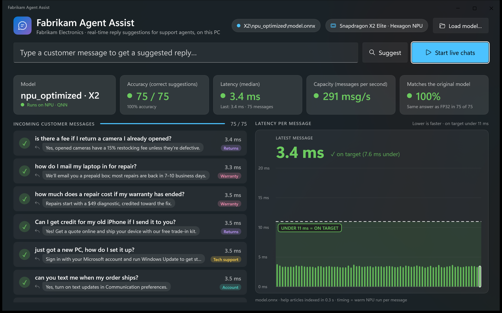

# Local Agent Assist (Windows ML)

Sample app running realtime reply suggestions for support agents at the fictional Fabrikam Electronics store, using an embedding model on the NPU with Windows ML.

The app is called **Fabrikam Agent Assist** on screen. Customer chat messages stream in; for each one the app embeds the message on the NPU, finds the best-matching help article from a 90-article knowledge base, and shows that article's ready-to-send reply for the support rep, whether it's correct, and how long it took. Load the **NPU baseline** model and most suggestions are wrong; load the **auto-optimized** model and they're all right, with lower latency.

> *Fabrikam Electronics* is a fictional company. All help articles and customer messages are made up.



*The app running the NPU optimized model: every suggested reply correct, ~3.4 ms per message, all bars inside the on-target zone.*

## Why an embedding model (not an LLM)?

Agent assist needs a suggestion for **every message, for every agent, within milliseconds**, privately and at low cost. That's a retrieval job: a ~110M-parameter embedding model on the NPU answers in about 4 ms.

## Requirements

| | |
|---|---|
| Device | Windows on Arm with a Qualcomm Hexagon NPU (tested on Snapdragon X2 Elite) |
| OS | Windows 11 24H2 (build 26100) or later |
| SDK | [.NET 10 SDK](https://dotnet.microsoft.com/download) (ARM64) |
| Runtime | [Windows ML](https://learn.microsoft.com/windows/ai/new-windows-ml/overview) via Windows App SDK 2.6 (NuGet, self-contained); the QNN execution provider is downloaded by `ExecutionProviderCatalog` on first run |
| Models | See [models/README.md](models/README.md) |

## Build and run

```powershell
cd src\FabrikamAgentAssist
dotnet build -c Release
.\bin\Release\net10.0-windows10.0.26100.0\win-arm64\FabrikamAgentAssist.exe
```

1. Startup (~5 s) registers Windows ML execution providers and indexes the help articles with the FP32 reference model on the CPU.
2. **Load model…** → `models\X2\npu_baseline\model.onnx` → **Start live chats**.
3. **Load model…** → `models\X2\npu_optimized\model.onnx` → **Start live chats** again.
4. Optionally type your own customer message and press **Suggest**.

### Rehearsal shortcuts

```powershell
FabrikamAgentAssist.exe --model <path> [--model <path> ...] [--traffic] [--query "<text>"]
```

`--model` can repeat (models load in order); `--traffic` runs live chats after each load.

## Settings

`appsettings.json` (next to the exe):

| Setting | Default | Meaning |
|---|---|---|
| `ModelsFolder` | `models` | Folder the **Load model…** dialog opens in |
| `ReferenceModel` | `models\X2\fp32\model.onnx` | FP32 model used for "Matches the original model" |
| `TrafficQuestionsPerSecond` | `4.5` | Pace of the live-chat stream (75 messages ≈ 17 s) |
| `WarmupRunsPerQuestion` | `3` | Untimed NPU runs before each timed run, so idle gaps between paced messages don't skew latency |

Relative paths are resolved against the first parent folder of the exe where they exist (e.g. the repo root). For machine-specific paths, create `src\FabrikamAgentAssist\appsettings.local.json` (same format, git-ignored); it's used instead of `appsettings.json` when present.

## What's on screen

| Stat | Meaning | Green when |
|---|---|---|
| Accuracy (correct suggestions) | Top article matches the labeled answer | ≥ 90% |
| Latency (median) | NPU inference time per message (warm run) | ≤ 11 ms |
| Capacity | 1000 / median latency | ≥ 90 msg/s |
| Matches the original model | Same top article as the FP32 model | ≥ 90% |

The latency chart shows one bar per message on a 0–20 ms scale, with a shaded on-target zone under 11 ms and a big readout for the latest message.

## Results (Snapdragon X2 Elite)

| | FP32 (original) | NPU baseline | **NPU optimized** |
|---|---:|---:|---:|
| Accuracy (correct suggestions) | 100% (75/75) | **5% (4/75)** | **100% (75/75)** |
| Accuracy (embedding similarity to FP32)¹ | 1.000 (reference) | **0.477** | **0.999** |
| Matches the original model | 100% (it *is* the original) | 5% | **100%** |
| Latency (median) | 41.3 ms | 18.0 ms | **4.2 ms** |
| Latency (P90) | 44.6 ms | 18.7 ms | **4.4 ms** |
| Capacity | ~24 msg/s | ~55 msg/s | **~237 msg/s** |
| Runs on | CPU (QNN fallback) | NPU · QNN | NPU · QNN |
| Precision | FP32 | w8a16 (uint8 weights, uint16 activations) | w8a16 (int8 per-channel weights, uint16 activations) |
| Model size on disk | 416 MB | 127 MB | 128 MB |
| Load + index 90 articles | ~6 s | ~2.2 s | **~0.8 s** |

The optimized model is **~4.3× faster than the NPU baseline** and **~10× faster than FP32 on the CPU**, with the same answers as the original model.

**How this was measured:** the app's own engine, 75 customer messages at 4.5 messages/s, 3 untimed warm-up runs before each timed run, median of the per-message timings, 3 rounds with the model order rotated (spread across rounds: FP32 40.9–42.6 ms, baseline 17.7–18.1 ms, optimized 4.18–4.24 ms). Snapdragon X2 Elite (X2E78100), plugged in, Windows power mode **Best performance**, QNN execution provider 2.2480.53.0, measured 2026-11-09. Absolute numbers vary between machines and sessions; compare the models within the table.

¹ Measured separately with `winml eval --mode compare` against the FP32 model on the CPU: mean cosine similarity of the model's output (every token) over 380 real text inputs; 1.0 = identical. A model is considered accurate at ≥ 0.99.

For stable numbers on your machine: plug in, set power mode to **Best performance**, and don't run other NPU workloads (e.g. `winml perf` / `winml eval`) at the same time.

## How the models were built

All three models are [BAAI/bge-base-en-v1.5](https://huggingface.co/BAAI/bge-base-en-v1.5). The two NPU models were built with the [Windows ML CLI](https://github.com/microsoft/winml-cli) (`winml`, v0.4.0), driven by GitHub Copilot with the Windows ML CLI agent skills ([`use-winml-cli`](https://github.com/microsoft/winml-cli/tree/main/skills/use-winml-cli) and [`auto-optimize`](https://github.com/microsoft/winml-cli/tree/main/skills/auto-optimize)). The recipes are in [`optimization/`](optimization).

| Model | How it was built | Why it behaves this way |
|---|---|---|
| **FP32 (original)** | ONNX export from [Xenova/bge-base-en-v1.5](https://huggingface.co/Xenova/bge-base-en-v1.5) (`onnx/model.onnx`, opset 11, dynamic input shapes). Not modified. | The app hands it to the QNN execution provider, but with dynamic shapes QNN can't take the graph, so it falls back to the CPU. Accurate but slow; it's also the app's accuracy reference. |
| **NPU baseline** | `winml build` with default settings: inputs fixed to 1×128, w8a16 quantization (per-tensor uint8 weights, uint16 activations), 10 calibration samples, ORT graph optimization only, compiled for QNN. Config: [`npu_baseline_config.json`](optimization/npu_baseline_config.json). | **Fast but wrong.** The attention mask adds the most negative float (−3.4e38) to padded positions; quantizing that range destroys the precision of real attention scores. The opset-11 GELU (Erf) also falls back to the CPU, splitting the model into 13 NPU partitions. |
| **NPU optimized** | Found by the **`auto-optimize`** skill, starting from the FP32 model with the goal *lowest NPU latency with cosine similarity ≥ 0.99 vs FP32*. It profiled the baseline, formed hypotheses, and built and measured 14 candidate recipes with `winml build`, `winml perf` and `winml eval`, keeping only changes that passed the accuracy gate and were faster. | See the winning recipe below. |

**Winning recipe (`auto-optimize`):**

1. **Fix input shapes to 1×128 and upgrade opset 11 → 17** ([`prepare_model.py`](optimization/prepare_model.py)), so GELU and LayerNormalization can be fused instead of decomposed. The whole model then compiles into a single NPU partition with no CPU fallback. *(Biggest speed win.)*
2. **Clamp extreme constants** (`clamp_constant_values`): the −3.4e38 attention-mask value becomes a large-but-finite number, so quantization keeps the resolution of real scores. *(Fixes accuracy.)*
3. **Graph fusions:** GELU, LayerNorm, MatMul+Add.
4. **Quantization:** static w8a16 with **int8 symmetric per-channel weights**, uint16 activations, 128 calibration samples.
5. **Compile ahead of time** to a QNN EP context (`.bin`), so the model loads in under a second.

Config: [`npu_optimized_config.json`](optimization/npu_optimized_config.json). To rebuild it (requires [winml-cli](https://github.com/microsoft/winml-cli) and the `onnx` Python package):

```powershell
python optimization\prepare_model.py models\X2\fp32\model.onnx build\model_static_op17.onnx
winml build -c optimization\npu_optimized_config.json -m build\model_static_op17.onnx -o models\X2\npu_optimized `
  --ep qnn --device npu --precision w8a16 --compile --no-analyze --rebuild
```

The compiled `.bin` is specific to the NPU it was built on (an X2 Elite build won't load on an X Elite and vice versa), so rebuild on your target device.

## How it works

| Path | What |
|---|---|
| `src/Engine/WordPieceTokenizer.cs` | BERT uncased WordPiece tokenizer (output verified identical to Hugging Face `tokenizers`) |
| `src/Engine/EmbeddingModel.cs` | **All the Windows ML code, marked `WINDOWS ML STEP 1–7`:** register execution providers, `PREFER_NPU` device policy, ONNX Runtime session, fixed 1×128 input, CLS pooling + L2 normalization |
| `src/Engine/SearchEngine.cs` | Knowledge base, FP32 CPU reference, cosine ranking |
| `src/FabrikamAgentAssist/` | WinUI 3 app (unpackaged, dark theme) |
| `src/FabrikamAgentAssist/Assets/kb.json` | 90 help articles (Orders, Returns, Billing, Account, Tech support, Warranty), each with a short ready-to-send `reply`. Only the title + body are embedded for matching; the reply is what the app shows |
| `src/FabrikamAgentAssist/Assets/traffic.json` | 75 labeled customer messages |
| `src/FabrikamAgentAssist/Assets/vocab.txt` | Tokenizer vocabulary from bge-base-en-v1.5 |
| `tools/make-icon.ps1` | Regenerates `Assets/AppIcon.ico` |
| `optimization/` | `winml build` configs for the NPU baseline and optimized models, plus `prepare_model.py` |
| `docs/images/` | Screenshots |

Windows ML setup, simplified:

```csharp
// Download (if needed) and register the certified execution providers for this PC, e.g. QNN for the Snapdragon NPU.
await ExecutionProviderCatalog.GetDefault().EnsureAndRegisterCertifiedAsync();

// Let Windows ML pick the execution provider and device: prefer the NPU, fall back to the CPU.
var options = new SessionOptions();
options.SetEpSelectionPolicy(ExecutionProviderDevicePolicy.PREFER_NPU);
var session = new InferenceSession(modelPath, options);
```

The app uses a [device policy](https://learn.microsoft.com/windows/ai/new-windows-ml/select-execution-providers#using-device-policies-for-execution-provider-selection) instead of explicitly choosing `QNNExecutionProvider` with `GetEpDevices()` / `AppendExecutionProvider`. On this device `PREFER_NPU` selects QNN on the Hexagon NPU, and in our tests it ran the optimized model faster (~3.5 ms) than explicit selection with `htp_performance_mode=burst` (~4.2 ms).

## Credits

- Embedding model: [BAAI/bge-base-en-v1.5](https://huggingface.co/BAAI/bge-base-en-v1.5) (MIT). `vocab.txt` is the model's tokenizer vocabulary.
- Built with [Windows ML](https://learn.microsoft.com/windows/ai/new-windows-ml/overview) and the [Windows ML CLI](https://github.com/microsoft/winml-cli).

## License

[MIT](LICENSE)
